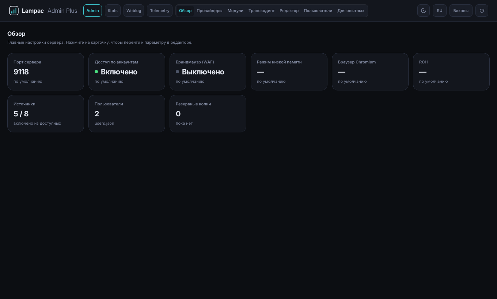
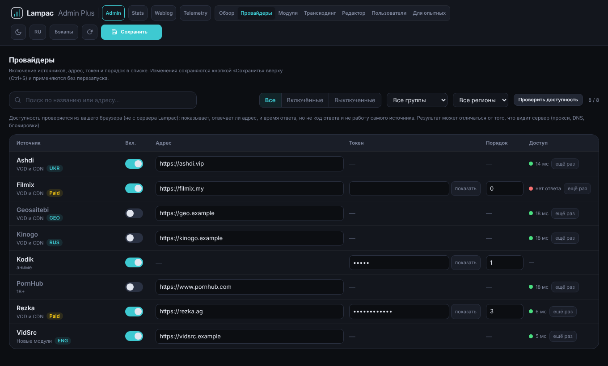
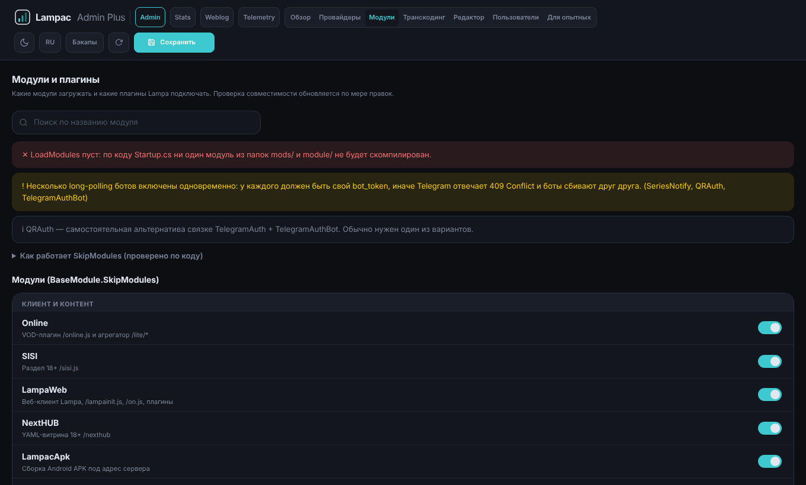
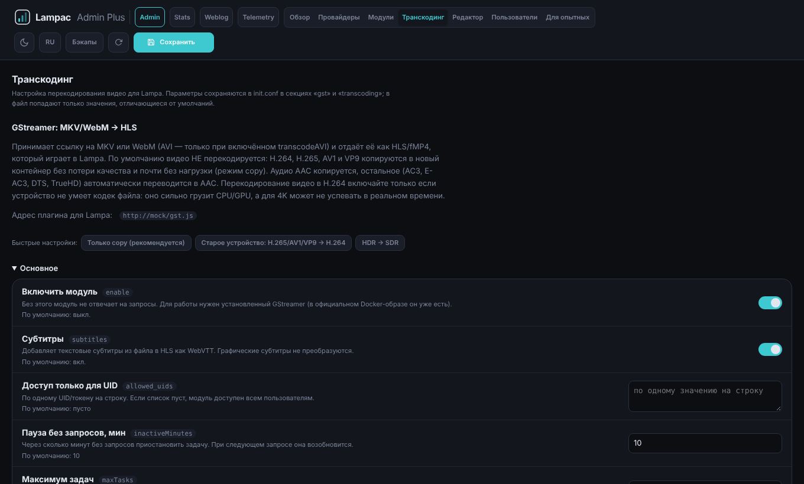
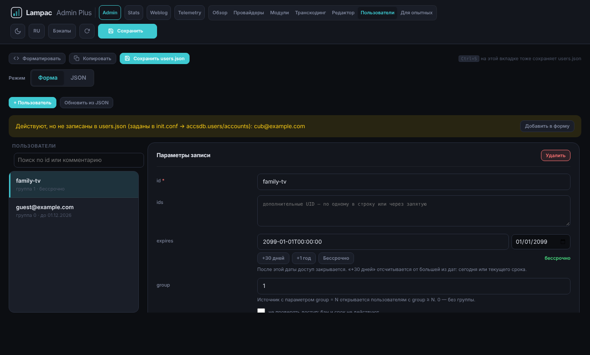
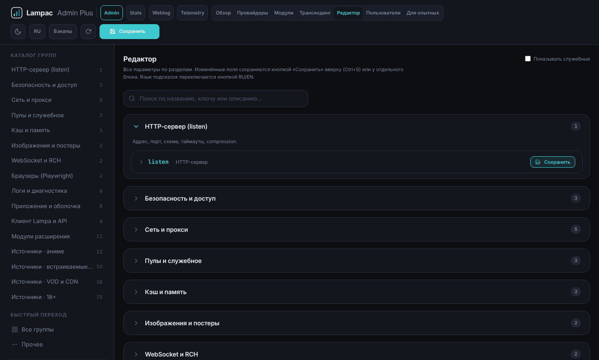

# lampac-adminpanel-plus

Улучшенная веб-админка для [lampac-nextgen](https://github.com/lampac-nextgen/lampac): тот же `/adminpanel`, но с понятными подсказками к параметрам и защитой от ошибочных правок. Основана на модуле `Modules/AdminPanel` (форк кода, не зависимость).

## Что добавлено

- **Подсказки к параметрам** на русском и английском (кнопка `RU/EN` в шапке): название, описание, бейдж «нужен перезапуск», предупреждение перед опасной правкой. Тексты лежат в `AdminPanelPlus/hints.json`. Описание провайдеров (`enable`, `host`, `token`, `displayindex`, `useproxy`, `streamproxy`) задано один раз и применяется ко всем источникам.
- **Вкладка «Провайдеры»**: все источники таблицей (включение, адрес, токен, порядок `displayindex`), поиск и фильтры, пакетное сохранение без перезапуска.
- **Вкладка «Модули»**: `SkipModules`, `LoadModules` и плагины `LampaWeb` с проверкой совместимости (каталог в `modules.json`, собран по исходникам lampac-nextgen).
- **Региональные метки провайдеров** (ENG, GEO, Paid, RUS, UKR) и фильтр по региону; **проверка доступности** адреса из браузера (не с сервера Lampac).
- **Вкладка «Транскодинг»**: настройки GStreamer (`gst`) и legacy Transcoding (`transcoding`) с пояснениями, быстрыми настройками и проверкой изменений.
- **Вкладка «Пользователи»**: форма и JSON для `users.json`, сроки доступа, поиск, показ пользователей, заданных в `init.conf`; `bypass_accsdb` не теряется при сохранении.
- **«Что изменится»** перед каждым сохранением `init.conf`: список «было → стало» (значения по умолчанию помечены, секреты не показываются).
- **Экспорт и импорт `init.conf`** (вкладка «Для опытных → init.conf»): скачать файл или заменить его своим с проверкой JSON и показом отличий; предыдущая версия уходит в бэкап.
- **Резервные копии** `init.conf` и `users.json` перед каждой записью из панели (кнопка «Бэкапы»): список, восстановление в один клик. Хранятся последние 30 копий каждого файла в `database/backup/adminpanel/`.
- **Сброс к умолчанию**: убрать ключ из `init.conf`, дальше действуют `base.conf` и значения ядра.
- **Маскировка секретов** в полях (`token`, `password`, `secret`, `apikey`).
- Панель больше не затирает повреждённый `init.conf` пустым объектом при сохранении секции: возвращает ошибку.

Подсказки есть не для всех параметров. Если описания нет, поле выглядит как в оригинальной панели. Добавить описание можно в `hints.json` (ключ — путь параметра, например `listen.port`).

## Скриншоты

Скриншоты сделаны на тестовых данных (адреса и токены вымышлены).

| | |
|---|---|
| <br>Обзор | <br>Провайдеры: регионы и проверка доступности |
| <br>Модули | <br>Транскодинг |
| <br>Пользователи | <br>Редактор |

## Установка

Панель использует те же маршруты, что и `AdminPanel` (`/adminpanel`, `/adminpanel/api/...`), поэтому **две панели одновременно включать нельзя**: маршруты совпадут.

1. Сделайте копию вашего `init.conf` и `users.json`.
2. Положите папку `AdminPanelPlus/` из этого репозитория туда, где у вас смонтирован каталог сторонних модулей (`mods/` или `module/`). Имя модуля равно имени папки, внутри должен лежать `manifest.json`.
3. Выключите старую панель: в её `manifest.json` поставьте `"enable": false` или уберите её папку из тома.
4. В `AdminPanelPlus/manifest.json` поставьте `"enable": true`.
5. Перезапустите контейнер: флаг `enable` читается при старте.
6. Откройте `/adminpanel/auth`. Пароль прежний, из файла `passwd`.

Бэкапы лежат в `database/`. Чтобы они переживали пересоздание контейнера, том `database` должен быть смонтирован (в `docker-compose.yaml` Lampac строка `./lampac-docker/database:/lampac/database` по умолчанию закомментирована).

### Автообновление из GitHub (по желанию)

Lampac умеет сам подтягивать модули из репозитория при старте. Запись в `module/repository.yaml` (или `mods/repository.yaml`, если такой файл у вас уже есть):

```yaml
- repository: https://github.com/smersh16/lampac-adminpanel-plus
  branch: main
  modules:
    - AdminPanelPlus
```

При обновлении `manifest.json` сливается, поля `enable` и `dynamic` берутся из уже установленной копии.

### Откат

Верните `"enable": true` у старой `AdminPanel`, у `AdminPanelPlus` поставьте `false` и перезапустите контейнер. Файлы конфигурации панель не меняет без вашего сохранения, а предыдущие версии лежат в `database/backup/adminpanel/`.

## Разработка

`AdminPanelPlus.csproj` нужен только для проверки сборки: положите папку в `Modules/` дерева Lampac и выполните `dotnet build Modules/AdminPanelPlus/AdminPanelPlus.csproj --nologo`. На сервере модуль компилируется из исходников по списку `tree` в `manifest.json`. Файлы `index.html`, `auth.html` и `hints.json` в список не входят, они читаются из папки модуля.

## Лицензия

[GNU AGPL-3.0](LICENSE). Модуль основан на коде `Modules/AdminPanel` проекта [lampac-nextgen/lampac](https://github.com/lampac-nextgen/lampac), распространяемого под той же лицензией, поэтому производная работа тоже под AGPL-3.0. Исходный код доступен в этом репозитории.
